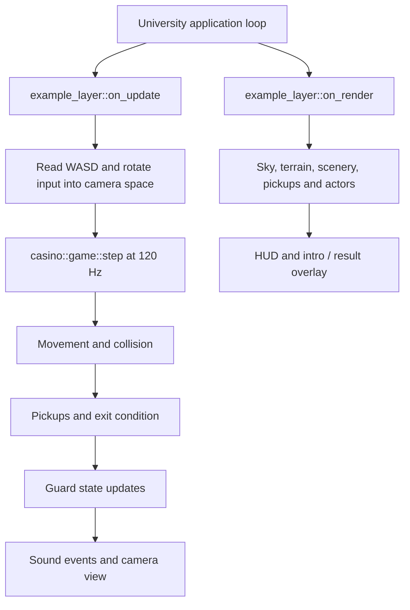

# Source organisation and review guide

## What to read, in order

| File | Responsibility | Main points to explain |
|---|---|---|
| `game/src/game.cpp` | Template application entry point | Creates the application, pushes `example_layer`, handles Escape |
| `game/src/example_layer.h` | Game-to-engine adapter declaration | Renderer/audio/mesh handles, camera, model slots and helper methods |
| `game/src/casino_game.h` | Engine-independent game class and simple data types | Round states, layout, movement, collision, pickups, guard states, tuning constants |
| `game/src/casino_geometry.h` | Procedural mesh construction | Triangle indices, normals, UVs, separate cylinder cap/side vertices |
| `game/src/casino_assets.h` | Asset configuration | Relative file paths, model height/facing corrections |
| `game/src/example_layer.cpp` | Engine-facing implementation | Loads assets; reads input; steps rules; follows player; renders world/HUD; plays events |
| `tests/casino_tests.cpp` | Headless regression checks | Rules/geometry validation; does not test rendered output or Windows linking |
| `tools/generate_placeholders.py` | Offline asset creation | Produces the three imported OBJ props, textures and synthesised WAVs |

`example_layer` retains the template's name to avoid changing existing Visual
Studio project entries. The three new game headers are included directly; no
project regeneration is required. The separate university engine is unchanged.

## Frame flow

The render frame duration is bounded before accumulating fixed simulation steps.
The rules see seconds, not a frame count, so movement does not depend on drawing
frequency. Pausing stops simulation timers. Rendering reads current state; a
camera shake changes the view, not the player's world position.

## Demonstrating the Milestone 1 criteria in the code

- **Primitives:** `cylinder_geometry()` creates vertices/indices at runtime. Side
  normals point away from the axis; top/bottom normals are vertical. The UV seam
  and caps use separate vertices, and cap winding matches the outward normal.
- **Transforms:** `draw_mesh()` composes translation, Y rotation and scale.
  `draw_model()` adds asset normalisation and ground alignment. Repeated chairs
  use different positions, opposing rotations and different scales.
- **Skybox:** `load_assets()` loads six faces through the university skybox class.
  `draw_world()` centres it on the camera and disables depth writes during its
  draw. The inherited shader's skybox branch bypasses lighting. The solid-colour
  placeholder is genuinely a textured skybox, not just `clear_color`.
- **Terrain:** `floor_geometry()` assigns UV ranges 0–12 and 0–10 to a 24 by 20
  ground plane. Both axes therefore use a two-metre tile size.
- **Camera:** `update_camera()` calculates an offset around the player from
  `m_camera_yaw`, smooths the desired position and sets a look-at view. Q/E changes
  the orbit. This replaces the template camera's independent free movement.
- **Imported meshes:** `load_model()` calls `engine::model::create()` on OBJ paths.
  The engine uses Assimp, then the adapter carries meshes, textures and per-mesh
  materials into a game object. They are made offline and imported at runtime;
  this is different from constructing the chip cylinder at runtime.
- **Theme and intro:** `draw_world()` composes casino props; `draw_hud()` contains
  the intro, controls and information. GUI refinement is a Milestone 2 item.

All objects ultimately become triangles on the GPU. For the marking scheme,
“primitive-based” describes geometry constructed in code, while “mesh-based”
here describes geometry imported from a model file. A model can be visually
simple and still use the required import path.

## Review against the supplied GitHub examples

Reviewed as examples, not proof that every inherited line represents the
student's personal style:

- `Gyryk/computer-graphics-module`, snapshot `e54311d`: `Lab1/Game.h` and `Game.cpp`.
- `Gyryk/asteroids`, snapshot `1cbeaa3`: `SRC/Bonus.h/.cpp` and
  `SRC/MovementController.h/.cpp` under `IN2026 Coursework Code`.
- The current repository's `Solve LAB01` changes (`9277286`).

Patterns visible in those samples include named gameplay classes, a header/source
split for larger classes, private/protected member state, short update/collision
methods and comments around graphics operations. Naming varies with each module's
template: PascalCase methods and `mMember` appear in Asteroids; the graphics lab
mixes `m_`/Hungarian prefixes; AGT uses `snake_case` and `m_` members. Accordingly,
the casino follows **the AGT template's** naming instead of mixing conventions.

The casino already separates the engine adapter from game rules, geometry and
asset paths, with explanatory comments at the key calculations. It does not
copy code from the two comparison repositories. Their licences are therefore
not new dependencies of this game.

Differences to understand rather than hide:

- `casino::game` is currently header-only. This keeps it testable and avoids
  modifying the supplied Windows project configuration. A conventional `.h/.cpp`
  split would be reasonable later if the class grows; it is not a prerequisite
  for the code to be logically organised or to use classes.
- The game state is public so the adapter can read it and headless tests can set
  up situations. This is convenient for a small prototype but weaker encapsulation
  than the private-state style in `Bonus`. Read-only accessors and explicit test
  setup interfaces are potential later improvements.
- `example_layer.cpp` still combines scene construction and HUD rendering. Splitting
  the HUD into a small class during the planned redesign would reduce that file's
  responsibilities. There is no need to introduce an entity-component system.
- Some initialisation and tiny helpers are compact one-line code. Readability and
  consistent formatting matter more than copying every stylistic habit from an
  older template. Avoid large cosmetic rewrites immediately before submission.

## Questions to work through before submitting

1. Why does the cylinder use different vertices/normals for its caps and sides?
2. Why does the floor need different UV repeat counts on its two axes?
3. How does Q/E orbit differ from the template camera? Why rotate WASD input too?
4. How are imported model textures associated with the right meshes?
5. Why is the skybox translated with the camera and drawn without depth writes?
6. Which methods change game state, and which only render it?
7. What do the automated tests prove, and what still needs a Windows playtest?
8. Which parts came from the university template, which were AI-assisted, and
   what did you select, test and change yourself?

This guide supports understanding and review. It is separate from the assessed
one-to-two-page interim report and the complete AI-use appendix.
